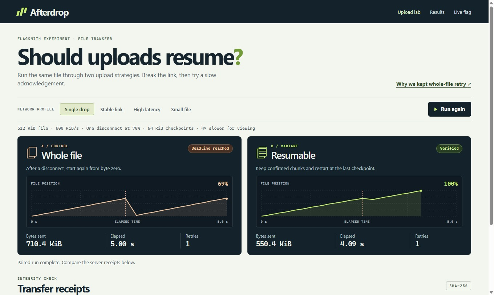
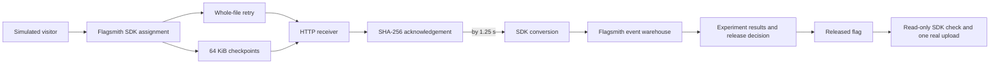

# Afterdrop

**Would you ship a change that wins by 42.5 percentage points?** In a Flagsmith experiment, 64 KiB checkpoints rescued interrupted uploads but timed out for every visitor on a stable, high-latency link. We kept whole-file retry as the default. Afterdrop lets an upload SDK team inspect that decision from real file bytes to the currently served flag.

Built for WeMakeDevs Toggle Wars, Track 01, Test Something Real.

[Watch the demo](submission/afterdrop-demo.mp4) · [See the experiment and release decision](evidence/report.md) · [Read the frozen protocol](PROTOCOL.md)

Across the fixed workload, verified on-time uploads rose from **38/83 to 68/77**. On the stable, high-latency link the comparison reversed, **11/11 to 0/9**. We ended the experiment on control. [View the completed Flagsmith dashboard](evidence/flagsmith-dashboard.png).



## Try the upload lab

Requires Python 3.10 or later. From the repository root:

```sh
python upload_lab.py serve --port 8765
```

Open <http://127.0.0.1:8765>. Run the interrupted link, then the high-latency link. Each lane shows sent bytes, acknowledged progress, time and the resulting receipt. The visual lab slows the network pacing and deadline together for readability. Its requests stay outside the recorded experiment.

Choose **Results** in the navigation for the completed campaign, its subgroup counts and the downloadable session ledger.

On that page, change the interrupted share to **20%**. With the remaining three profiles in a fixed 2:1:1 ratio, both strategies project 80% completion. That is a reweighting of measured subgroup rates. To see which strategy the platform serves *now*, run the live check on a stable link. It needs a configured SDK environment; the [recorded control, resume and disabled checks](evidence/live-release-check.json) are available offline.

## How Flagsmith changes what runs

The benchmark asks the official Python SDK for the experiment variation **before each visitor's first upload**. Control sends the entire file per request. Resume sends 64 KiB per request and resumes at the last acknowledged offset. One identifier follows the visitor through retries. The official SDK records exposure on evaluation. It sends `upload_verified_on_time` only when the receiver's digest matches the input and the client receives that acknowledgement by 1.25 seconds.

Experiments run in an actual self-hosted Flagsmith instance with a PostgreSQL event warehouse and a separate task processor. Flagsmith chooses the variation, counts exposures and conversions, and calculates the comparison. The independent receiver audit makes every reported success traceable to a file.



The lab runs on Python's HTTP server with a vanilla JavaScript front end. Server memory holds the file bytes during each attempt. CSV and JSONL preserve experiment evidence. The live check reads an environment default without identity, exposure or conversion events. Failure to fetch the live value is shown explicitly. [Detailed result screen](evidence/release-decision.jpg)

## Reproduce the platform experiment

1. Follow [the local Flagsmith setup](deploy/README.md) to start a fresh instance, connect its warehouse and install the official CLI v2. Create a Python virtual environment and install the SDK with `python -m pip install -r requirements.txt`.
2. Set `AFTERDROP_ENV_FILE` to the settings file generated by the bootstrap. In PowerShell, use `$env:AFTERDROP_ENV_FILE='.local/flagsmith-host/experiment.env'`. The CLI must be on PATH or supplied via `FLAGSMITH_CLI`.
3. Use an unused flag name for each independent experiment. For example, set `$env:AFTERDROP_FLAG='afterdrop_reproduction_01'`. Run the following with the virtual environment active:

```sh
python manage_experiment.py setup
python upload_lab.py run --mode flagsmith --out .local/reproduction
python audit_run.py .local/reproduction
python manage_experiment.py refresh
python manage_experiment.py read --out .local/reproduction/platform.json
python reconcile.py .local/reproduction .local/reproduction/platform.json
```

The results task is asynchronous. If the first read returns an empty result, read again after computation. Inspect the subgroup guardrails in the run summary alongside the official inference. For a shakedown, choose a separate flag and output directory and pass `--smoke` to the runner. Use a fresh experiment after an interrupted run. The study ledger reserves its output directory before enrolment.

If your reproduction also breaches the guardrail, run `python manage_experiment.py hold-control` in that same shell to end your reproduction on control. To use its released flag in the web lab, set `$env:AFTERDROP_RELEASE_FLAG=$env:AFTERDROP_FLAG` (POSIX: `export AFTERDROP_RELEASE_FLAG="$AFTERDROP_FLAG"`), then run `python upload_lab.py serve --port 8765` from the configured virtual environment. Open **Results → live check**. Refresh the platform results after the platform's cooldown to obtain a sealed final snapshot. You can verify the recorded competition experiment offline with:

```sh
python reconcile.py results/official evidence/platform.json --release evidence/release.json
```

To test just the transport with no platform dependency, run `python upload_lab.py run --mode local --out .local/paired`. This pairs the two strategies for each identity. To run transfer regression tests, use `python -m unittest discover -s tests`.

## Evidence included

- [Official platform results](evidence/platform.json), [session ledger](results/official/sessions.csv), [server receipts](results/official/server-receipts.jsonl) and [independent reconciliation](evidence/reconciliation.json).
- [Instrumentation amendment](evidence/telemetry-amendment.md) and the [first platform snapshot](evidence/platform-initial.json) explain a discarded run with incomplete event delivery.
- [English demonstration script](submission/video-script.md).
- [Secondary paired sensitivity check](evidence/sensitivity.md). With 35 ms per request and an early disconnect, whole-file retry completed 4/4 and checkpoints 0/4. This check generated no new A/B events.
- [Clean-instance replication](competition_review/verification/clean-instance/README.md). A fresh PostgreSQL volume and separate Flagsmith instance assigned another 160 visitors. Whole-file retry finished 34/84 and resume 67/76. The high-latency subgroup again finished 11/11 versus 0/9. These counts are separate from experiment 3.

## Scope

The workload uses generated files, one host, paced loopback transfers, serial chunks and a fixed wall-clock deadline. The interruption-prone visitor share is chosen for a stress test. Parallel multipart uploads, packet-level radio behavior, persistent storage and customer adoption were outside the measured conditions. The product question is relevant to real resumable protocols, which also track offsets or completed parts. [tus protocol](https://tus.io/protocols/resumable-upload) · [Amazon S3 multipart uploads](https://docs.aws.amazon.com/AmazonS3/latest/userguide/mpuoverview.html)

This project was built and tested with Codex. The recorded transfers, local Flagsmith deployment, counts and dashboard captures come from actual runs.
